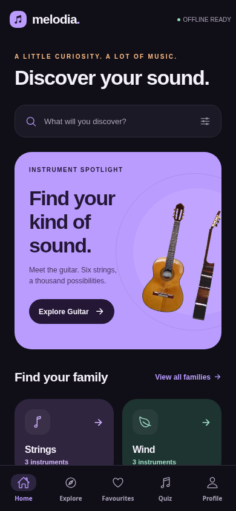
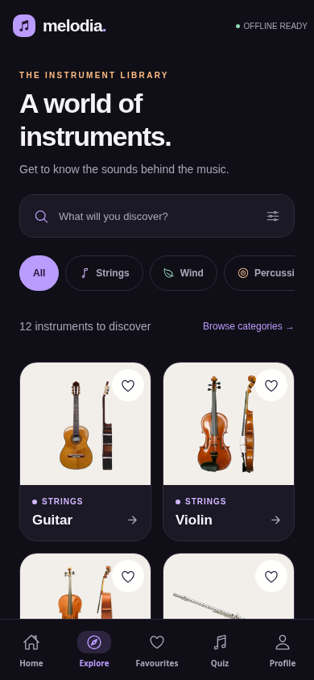
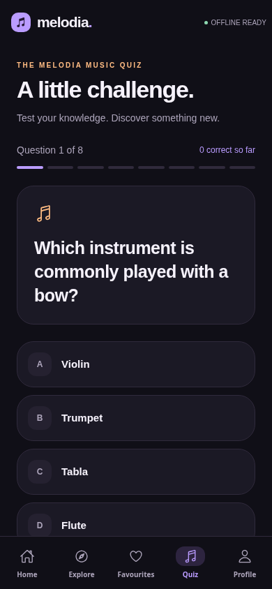
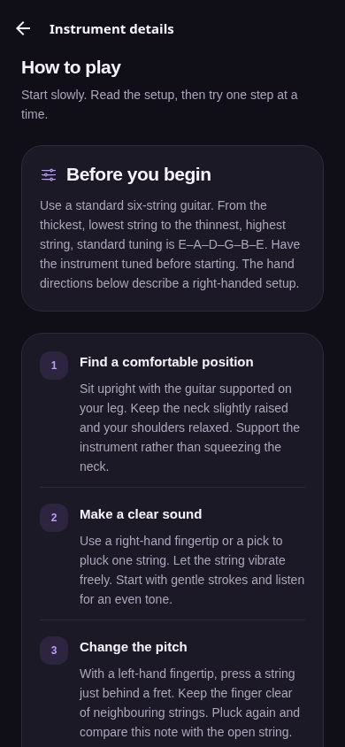
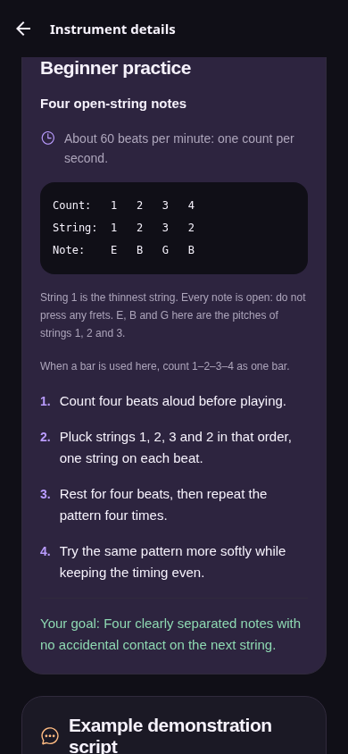
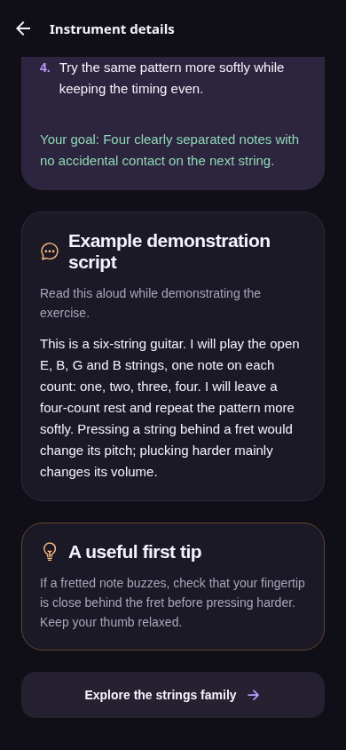

# Melodia

Version 1.2 adds step-by-step playing methods, original practice patterns and read-aloud demonstration scripts for all 12 instruments. Open an instrument and scroll to **How to play**, **Beginner practice** and **Example demonstration script**. These are text guides to try on a real instrument; no audio playback was added.

The modern interface includes a modern dark interface, a purple instrument spotlight, family cards, responsive instrument grids, card-level favourite buttons and quiz progress/answer feedback. It uses the existing local dataset and storage format.

  

Offline React Native / Expo SDK 54 learning project. Eight screens: Home, Explore, Categories, Search, Details, Favourites, Quiz, Profile.

## Run
Install a supported Node.js LTS version (Node 22 recommended). In this folder run:

    npm ci
    npx expo start

Use an Android emulator, iOS simulator on macOS or Expo Go compatible with SDK 54. If the current store client uses a different SDK, use a matching development build or follow Expo's SDK upgrade instructions. Browser preview: npm run web.

The first dependency installation and image setup need internet. The application uses only bundled JSON/images and AsyncStorage. A Metro preview needs its development server. A standalone native build is required for an airplane-mode cold-launch demonstration. This source ZIP is not an APK.

## Understand the files
src/data holds 12 curated instrument records and eight questions. The answer field is the zero-based option index. src/components contains reusable UI. src/screens contains eight screens. src/storage loads and saves the shared library. src/navigation defines tabs and stack navigation. src/theme holds styles and colours.

Favourites and saved quiz scores persist. Tap Save score to profile after completing a quiz. The latest 50 saved results are retained. Unfinished quizzes are temporary and restart after closing the app.

Popular picks are a fixed editorial selection. Keyboard is a browsing category; piano also uses struck strings. Wind includes brass and woodwind instruments.

Review STUDY_GUIDE.md and TESTING.md. Adapt and understand the project, follow your lecturer's rules for assistance, and do not claim generated code or third-party photographs as independently authored work. Source photos and licences are in assets/image-credits.json and Profile. Title registration and final coursework submission remain your responsibility. Make real commits as you work; do not invent past history.

Image downloads were performed only during project preparation. The generated application contains no network-fetch logic. Keep the image credits when redistributing the project.

## Instrument learning reference

[INSTRUMENT_GUIDE.md](INSTRUMENT_GUIDE.md) collects every playing method and example script in one offline document. The app displays the same content dynamically from src/data/instruments.json through the reusable PlayingGuide component.

Each guide states its assumed instrument type or setup. It provides four playing steps, an exercise with counts/notes or strokes, notation explanations, a goal, a spoken demonstration and a beginner tip. The short patterns are original learning examples, not recordings or complete pieces.

Run `npm run check` to check that every instrument has its full guide, local image and unique script.

  
